  <picture>
    <source media="(prefers-color-scheme: dark)" srcset="./images/header-dark.svg">
    <source media="(prefers-color-scheme: light)" srcset="./images/header-light.svg">
    
  </picture>

  <i>I break things to understand them at the finest level: hardware, firmware, and the radio waves that connect them.</i>

  
  

 

<table align="center">
<tr>
<th width="50%"><h2>Experience</h2></th>
<th width="50%"><h2>Focus</h2></th>
</tr>
<tr>
<td valign="top">

<h3>Penetration Tester</h3>

<i>Arvato Systems Romania</i> Since 2026

<h3>Penetration Tester</h3>

<i>Lynx Security</i> Since 2026

<h3>Junior Software Engineer</h3>

<i>Mitel Networks Romania</i> Since 2026

<h3>B.Eng. Electronics & Communications</h3>

<i>Transilvania University of Brașov</i> 2022 to 2026

</td>
<td valign="top">

<h3>Wireless & physical layer security</h3>

Wi-Fi, sub-GHz and IoT attack surfaces

<h3>Software defined radio</h3>

Capture, analysis and replay with SDR, GNU Radio and URH

<h3>Hardware & firmware</h3>

Teardowns, drivers, embedded C and Rust

<h3>Community</h3>

Speaker and member of the Brașov Cybersecurity Community

</td>
</tr>
</table>

 

<h3 align="center">Featured Projects</h3>

<table align="center">
<tr>
<td width="50%" valign="top">
<a href="https://github.com/DarkSoulEngineer/CC1101_DRIVER"><b>CC1101_DRIVER</b></a> 
Low-level driver for the CC1101 sub-GHz RF transceiver. 
<code>C</code> <code>Embedded</code> <code>RF</code>
</td>
<td width="50%" valign="top">
<a href="https://github.com/DarkSoulEngineer/CST-MATLAB-2.4Ghz-Antenna"><b>CST-MATLAB-2.4Ghz-Antenna</b></a> 
2.4 GHz microstrip antenna, designed and simulated with CST and MATLAB. 
<code>MATLAB</code> <code>CST</code> <code>RF</code>
</td>
</tr>
<tr>
<td valign="top">
<a href="https://github.com/DarkSoulEngineer/DOS-X_ASM"><b>DOS-X_ASM</b></a> 
16-bit graphics application that draws directly into VRAM. 
<code>x86 Assembly</code>
</td>
<td valign="top">
<a href="https://github.com/DarkSoulEngineer/RTSP_TO_HTTP"><b>RTSP_TO_HTTP</b></a> 
Bridge that serves RTSP camera streams over HTTP. 
<code>Python</code> <code>Networking</code>
</td>
</tr>
<tr>
<td valign="top">
<a href="https://github.com/DarkSoulEngineer/infoTRON"><b>infoTRON</b></a> 
Informatics learning platform for Mechatronics students. 
<code>Web</code> 

</td>
<td valign="top">
<a href="https://github.com/DarkSoulEngineer/windots"><b>WinDots</b></a> 
Windows dotfiles and environment setup. 
<code>PowerShell</code> 

</td>
</tr>
</table>

 

<h3 align="center">Talks</h3>

<table align="center">
<tr>
<td width="120" align="center"><b>Sep 2026</b></td>
<td>
<b>Wireless Security: when your router is mad at you</b> 
CyberTechMeetup #3 · Brașov Cybersecurity Community · hosted by Arvato Systems Romania 
Wardriving, deauth and evil-twin attacks, packet crafting with Scapy, IoT and WPA3 weaknesses, live demo. 

</td>
</tr>
</table>

 

<h3 align="center">Technologies & Tools</h3>

<table align="center">
<tr>
<td align="right"><b>Languages</b></td>
<td>

</td>
</tr>
<tr>
<td align="right"><b>Web</b></td>
<td>

</td>
</tr>
<tr>
<td align="right"><b>Data &amp; Solvers</b></td>
<td>

</td>
</tr>
<tr>
<td align="right"><b>Security</b></td>
<td>

</td>
</tr>
<tr>
<td align="right"><b>RF</b></td>
<td>

</td>
</tr>
<tr>
<td align="right"><b>Hardware</b></td>
<td>

</td>
</tr>
<tr>
<td align="right"><b>Tools</b></td>
<td>

</td>
</tr>
<tr>
<td align="right"><b>Automation</b></td>
<td>

</td>
</tr>
<tr>
<td align="right"><b>Productivity</b></td>
<td>

</td>
</tr>
<tr>
<td align="right"><b>Virtualization</b></td>
<td>

</td>
</tr>
<tr>
<td align="right"><b>OS</b></td>
<td>

 

</td>
</tr>
</table>
